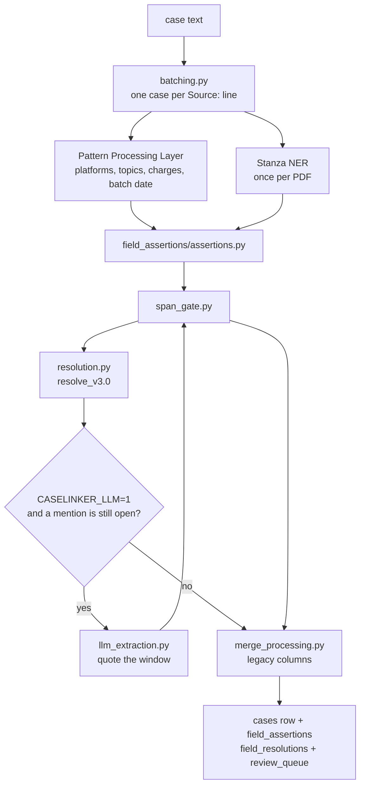

# Processing Layer

This layer turns one case narrative into structured fields. The detectors that run today are tuned on press releases and structured PDFs. The same gate and resolver accept a PACER filing, an investigative note, or a CyberTip once a detector is registered for that document.

The repo README is the one-page summary. This file is how extraction actually runs.

## Pipeline



`processing.py` is the entry (`process_cases`). `merge_processing.py` writes the resolved view into the columns the rest of the app already reads.

## Four readers, one decision

An age or a sentence is not stored because one function returned it. Each reader writes its own row: method, version, role, confidence, and a character span into the original text. `resolution.py` counts agreement by **family**. Two functions in the same family do not count as two votes.

| Reader | Family | What it is |
|---|---|---|
| Regex, spaCy token patterns | `surface_pattern` | Press-release grammar: "Name, 32,", "N-year-old", "charged Name (age 20)", "posing as", "faces up to" |
| spaCy dependency | `dependency` | Which noun the age hangs on, including "posed as" and "images of" |
| Stanza | `ner` | Person and number entities. The model runs once for the PDF; the detector only keeps an age when a person name sits on the number. A perpetrator role from the most-mentioned name is confidence 0.65, so Stanza can corroborate and cannot finalize alone |
| Local LLM | `llm` | Only the mentions the three above left unknown or in conflict |

Statute lookup (`lookup`) and temporal tags (`temporal`) are the same kind of reader for "under the age of 18", publication dates, and a sentence from an earlier case.

**Human review** is method `human`. Verdicts live in `config/victim_age_overrides.json` and win outright. Anything still open is a row in `review_queue`. That queue is the review list. It is not a person sitting in the ingest loop.

Rules, in order:

1. Human wins.
2. `unknown` is an abstention, not a competing role.
3. A family that asserts two roles for one mention abstains.
4. Two families that disagree veto the mention. It does not become a final.
5. One role from two families is `agreed`. One family at confidence ≥ 0.7 is `resolved`. Below that, the mention stays in review.
6. A settled mention can finalize while another mention in the same case stays contested.
7. No numeric threshold. 18 is not a defendant because it is 18. 14 is not a victim because it is 14.

A wrong final is worse than review.

## What lands in the old columns

`merge_processing.py` fills the fields the graphs and the API already use:

- `perpetrator_age` and victim ages: settled perpetrator and victim ages only. Decoy, claimed, statutory, and depicted ages stay out.
- `prosecution_outcome.sentences`: imposed terms, supervised release, probation, and fines. Exposure ("faces up to") and a prior-case term do not. A booking goes on `jail`.
- CyberTip: only when the tip is about this case, not a "report a tip" footer.
- `date_range`: the publication day from the release when the batch date was only a year or a month.

Per-method rows are not copied into the JSON blob. They are `field_assertions`, `field_resolutions`, and `review_queue`. MCP reads them with `get_case_assertions` and `get_field_disagreements`.

The CAC mapper (`ontology/features_to_cac.py`) still reads those legacy columns. A regenerated graph picks up cleaner ages, sentences, and dates. It does not yet draw a decoy role or an assertion edge.

## LLM

Off unless `CASELINKER_LLM=1`. Default runtime is local Ollama, model `qwen3:8b`. Set `CASELINKER_LLM_PROVIDER=openai_compat` and `CASELINKER_LLM_BASE_URL` for another endpoint.

It reads sentence windows, not the document. It must return a quote that occurs once in that window and covers the mention. Confidence is 0.6, under the 0.7 line, so it can confirm a deterministic family or veto one. It cannot finalize a value by itself. Transport errors and truncated replies are not cached.

`scripts/run/propose_compiled_rule.py` can draft one regex from quotes a reviewer has already confirmed. The draft does not run. It runs only after that dict is committed in `field_assertions/compiled_rules.py` (`APPROVED`). None are approved.

`scripts/run/reresolve_assertions.py` re-runs resolution over stored rows without re-extracting.

## Location grounding

After locations are merged, `location_grounding.py` links each mention to a US Census FIPS entity when the gazetteer is present (`data/gazetteer/`, fetch with `scripts/run/fetch_gazetteer.sh`). Results land on `location_grounds` and are stored with extracted features. The CAC mapper mints `location/fips/{geoid}` IRIs for grounded rows so the same county name in two states does not share one slug. This is **not** a resolve_v3.0 family vote — witnesses settle the text span; grounding settles the real-world referent.

## Document kinds

`field_assertions/detectors.py` registers detectors by kind. `press_release` is the live set. `pacer`, `investigative_note`, and `cybertip` are accepted kinds with no press-release detectors. Register one function; it returns the same assertion dicts. The gate and the resolver do not change.

```python
from detectors import register_detector

def pacer_ages(ctx):
    return [...]

register_detector("pacer_ages", ("pacer",), pacer_ages, order=10)
```

## Layout

| Path | Role |
|---|---|
| `processing.py` | `process_cases`: pattern extract, Stanza bulk, spaCy batch, assertions, resolve, merge |
| `batching.py` | Split a merged PDF into cases. Scraped PDFs split on `Source: https://` |
| `merge_processing.py` | Resolved view → legacy columns |
| `field_assertions/` | Collect, span gate, resolution, compiled rules, detector registry |
| `Pattern Processing Layer/` | Regex producers, statute lookup, temporal tags, the older pattern extractors |
| `ML Processing Layer/` | Stanza NER, spaCy patterns, semantic concepts, optional LLM |
| `victim_age_gate.py`, `victim_age_overrides.py`, `gender_extraction.py` | Age-gate validators and human overrides |
| `agency_label_normalize.py`, `agency_context_gate.py`, `agency_possessive_repair.py` | Agency strings |
| `location_grounding.py` | Post-extract Census FIPS linker → `location_grounds` |
| `source_url_gate.py`, `source_url_continuations.py` | Duplicate-URL gate and wrapped `Source:` lines |

## Run

From the repo root, one PDF:

```bash
export SKIP_PRECOMPUTE_CLUSTERS=1
python3 src/main.py "RIAG_ICAC_All.pdf"
```

Every PDF in the repo root, models kept warm, cluster rebuild skipped:

```bash
./scripts/run/ingest_all_pdfs.sh
```

`--no-aggregate` skips NCMEC and the large DOJ compilations. LLM stays off for that command unless `CASELINKER_LLM=1` is already set. Leave it off for a corpus ingest. Turn it on for a residue pass after deterministic resolution.

Tests: `tests/test_field_assertions.py`. It runs real excerpts through extract → resolve → the legacy fields.
